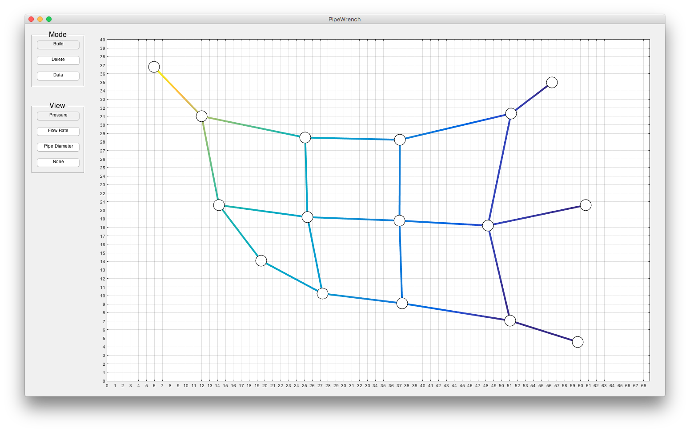

# PipeWrench

PipeWrench solves pressure and flow in networks of circular pipes using a
finite element conductance model. The model assumes laminar, Newtonian,
fully developed flow and neglects minor head losses and elevation effects.
The source includes a MATLAB GUI, while the FluidNetwork, Junction, and Pipe
classes can be used without it.

## Get started

Download PipeWrench from [MATLAB File Exchange](https://www.mathworks.com/matlabcentral/fileexchange/53480-pipewrench)
or clone this repository. Add the downloaded or cloned folder to your MATLAB
path, then run `test_network` to check the core solver in your environment.
The optional GUI starts with `pipewrench_gui`.

The automated tests run the core solver with MATLAB on GitHub Actions. Older
MATLAB releases and Octave have not been revalidated, and the GUI is not
covered by those tests.

## Example

    net = FluidNetwork();
    net.dynamic_viscosity = 1e-3;             % Pa*s
    net.add_junction('in', 0, 0, 'pressure', 1000); % coordinates in m, pressure in Pa
    net.add_junction('out', 2, 0, 'pressure', 0);
    net.add_pipe('pipe', 'in', 'out', 'diameter', 0.1); % diameter in m
    net.solve();
    flow = net.get('pipe', 'flow_rate');       % m^3/s

Pipe lengths are calculated from the two-dimensional junction coordinates.
The Pipe.resistance property has a historical name: it stores hydraulic
conductance (flow divided by pressure difference), not resistance. Supply
positive, finite viscosity and diameters and distinct endpoint coordinates.
Each connected component needs a fixed-pressure junction.

Run test_network from this folder for an analytical single-pipe check,
equal-pipe series check, and a conservation check on a larger network.
GitHub Actions runs the same script on pushes and pull requests.

The original source authored by Chris McComb is licensed under BSD 3-Clause;
see [LICENSE](LICENSE). The optional GUI bundles SplashScreen.m from a
separate MathWorks File Exchange submission. Its different license and
attribution are preserved in [THIRD_PARTY_NOTICES.md](THIRD_PARTY_NOTICES.md).
That component's terms limit its use to MathWorks products and services.

